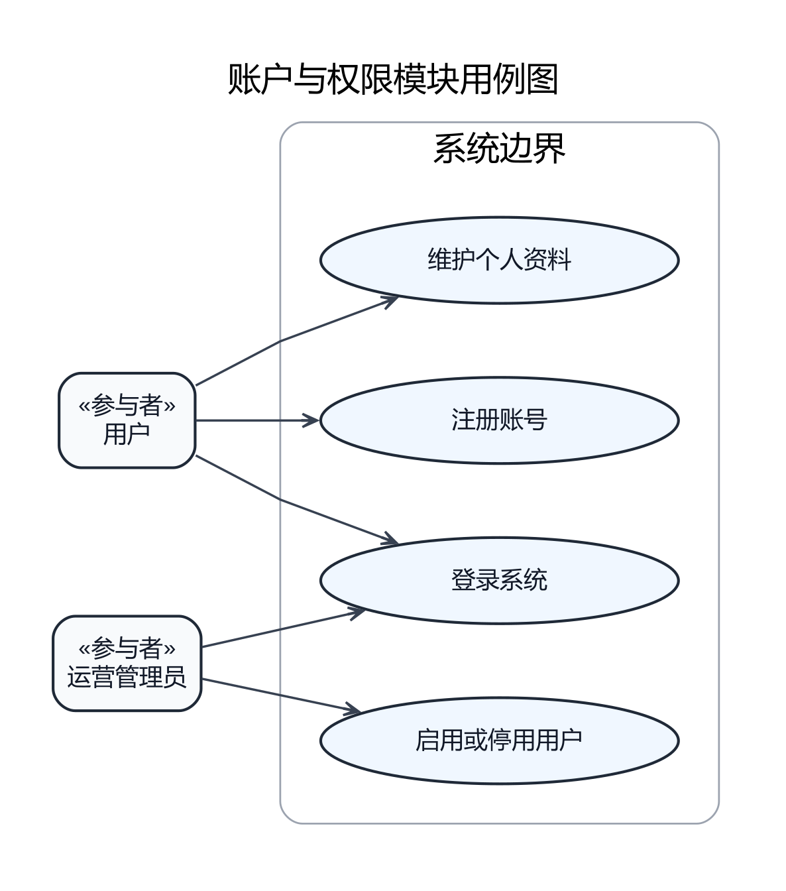
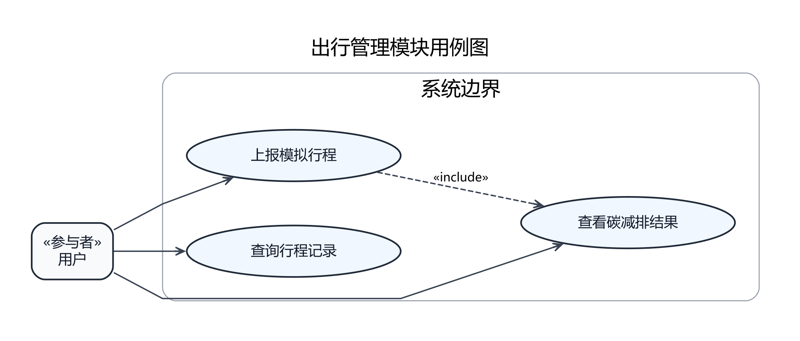
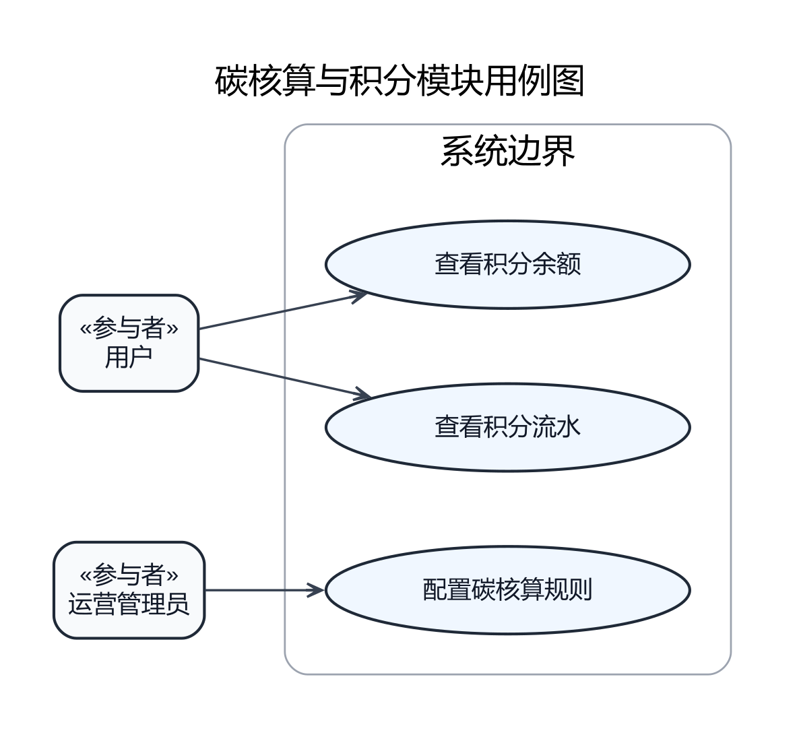
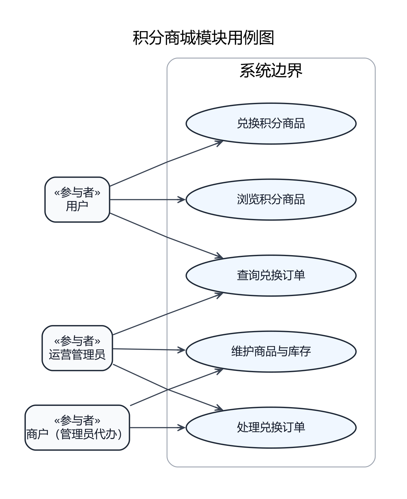
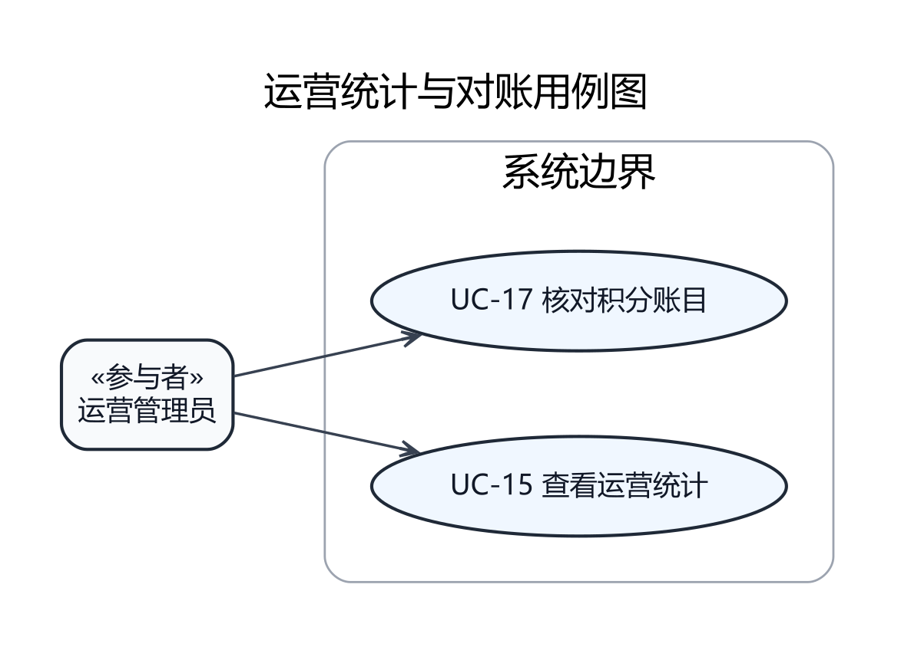
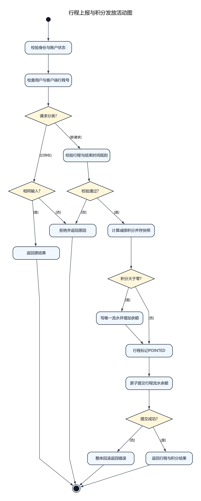
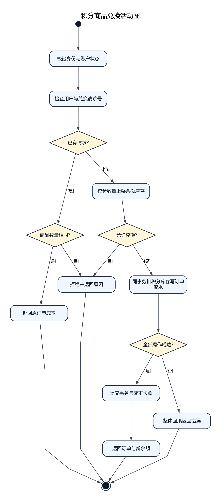
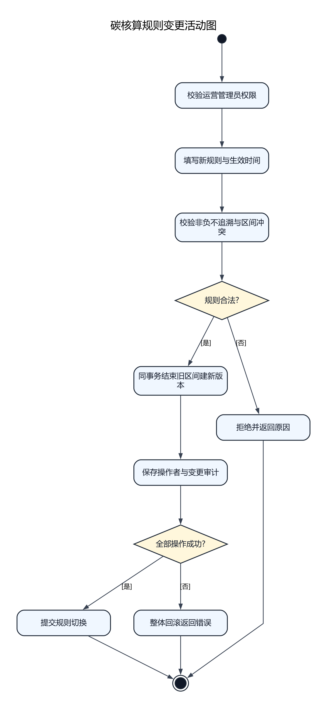
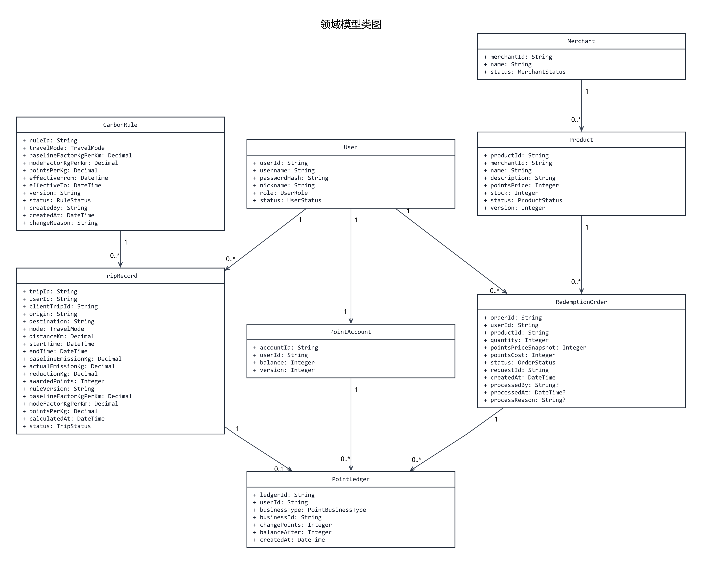

# StarUML图文件

推荐在本页直接查看下方9张图片。需要编辑时，使用 StarUML 打开 [综合工程](lab1-all-models.mdj)；每张图也保留独立 `.mdj` 文件。

| 文件 | 类型 | 模型清单 |
| --- | --- | --- |
| `account-use-cases.mdj` | 用例图 | 2个参与者、4个用例、5条关系 |
| `domain-model.mdj` | 领域类图 | 8个类、71个属性、9条关系 |
| `mall-use-cases.mdj` | 用例图 | 3个参与者、5个用例、8条关系 |
| `operations-use-cases.mdj` | 用例图 | 1个参与者、2个用例、2条关系 |
| `points-use-cases.mdj` | 用例图 | 2个参与者、3个用例、3条关系 |
| `redemption-activity.mdj` | 活动图 | 9个动作、18条控制流 |
| `rule-change-activity.mdj` | 活动图 | 8个动作、13条控制流 |
| `trip-point-issuance-activity.mdj` | 活动图 | 11个动作、22条控制流 |
| `trip-use-cases.mdj` | 用例图 | 1个参与者、3个用例、4条关系 |

运营图包含UC-15统计和UC-17对账；UC-16启停用户只归账户模块。商城保留“商户（管理员代办）”表达业务利益相关者，MVP无商户登录接口。完整角色边界见业务规则BR-08。

领域模型按domain-model.md的属性重新生成；新增客户端幂等键、起终点、规则因子快照及订单成本和处理信息。活动图按结束时间规则、幂等重放、零积分和本地事务回滚更新。动作中的业务写入在同一本地事务内，任意异常（含提交失败）回滚，权限失败立即拒绝；图中通用错误处理的详细判定见business-rules.md。

沿用MIT许可的staruml-mcp-server生成器；综合工程由独立工程合并，不手工维护第二套语义。结构检查包括唯一ID、引用、父子关系、独立与综合一致性以及文档字段对应。结构检查不等于StarUML实际渲染验证；交付报告前仍需打开工程检查连线、标签和边界，再导出PNG。不得把文档中的预期测试场景写成已通过测试。

## 图片预览

以下PNG读取各 `.mdj` 的模型元素、属性、关系和活动流，由开源 Graphviz 重新排版生成，供 GitHub 在线查看。参与者以 `«参与者»` 方框表示，活动判断菱形显示模型中的判断名称。图片与 StarUML 中的视觉布局可能不同，**不是 StarUML 原样导出的截图**；`.mdj` 仍是可编辑模型的依据。更新模型后应同步更新对应图片，并检查图与模型的一致性。

### 账户与权限模块

### 出行管理模块

### 碳核算与积分模块

### 积分商城模块

### 运营统计与对账模块

### 行程上报与积分发放

### 积分商品兑换

### 碳核算规则变更

### 领域模型

